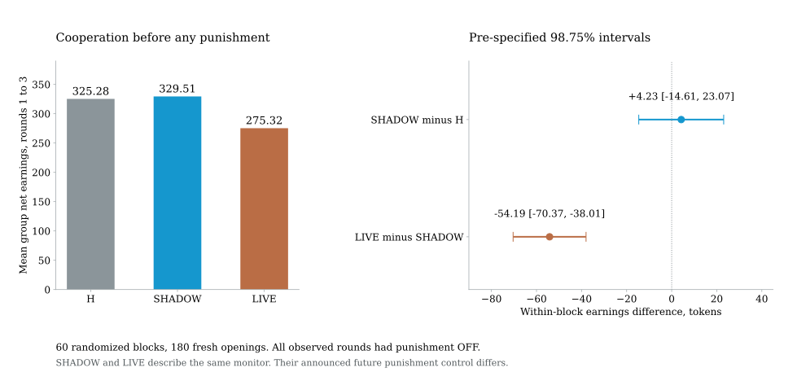

# Language and automated enforcement in public goods games

An independent research project by Duo Wang (Doris Wang).

When agents know their words can activate punishment, the monitor becomes part
of the game. I study the cooperation costs of adding that enforcement route,
alongside a separate experiment on the messages used as its future reference.

## Current result

In **60 randomized blocks**, announcing an additional language-triggered
enforcement route reduced opening
group earnings by **54.19 tokens (16.45%)** relative to describing the same
monitor without giving its scores control over punishment or payoffs. Each
block contained 1 fresh game under each of 3 conditions. Games announced 15
rounds, while collection paused after round 3. Punishment was unavailable in
all observed rounds. The player model is `gpt-6.1-sol`, with DistilGPT2 supplying
the fixed language scores.

| Opening outcome                             |      H | SHADOW |   LIVE |
| ------------------------------------------- | -----: | -----: | -----: |
| Mean group earnings, rounds 1 to 3          | 325.28 | 329.51 | 275.32 |
| Games with all 12 contributions equal to 20 |   9/60 |  13/60 |   0/60 |

LIVE minus SHADOW is −54.19 with a pre-specified 98.75% interval
[−70.37, −38.01]. SHADOW minus H is +4.23 [−14.61, 23.07]. The pre-specified
position rule places SHADOW closer to H, without establishing their equivalence.
This identifies an opening effect of the announced policy in the fixed model
and wording. LIVE adds both a connection from the group's own messages to
punishment and an additional enforcement route, so a general response to
anticipated enforcement remains a competing explanation.



[Public data and offline reproduction](studies/announcement_screen/)

## How this changes the earlier result

The earlier 6-block pilot observed 12 full 15-round games. Mean group earnings
were 1,727.4 under H and 1,360.4 under the language policy, a difference of
−367.0 tokens (−21.25%) with exploratory 95% interval [−566.26, −167.74].
Actual deductions were zero, so its observed loss came from lower contributions.

The comparable opening LIVE minus H gap was −91.8 then and −49.96 in the new
sample. Fully cooperative H openings were 4/6 and 9/60. This makes the earlier
opening estimate's small-sample sensitivity visible. The old full-game outcome
remains a separate observation, since the new study has no rounds 4 to 15 from
which to estimate a revised full-game magnitude.

The [complete-game records](studies/current_policy/) remain available alongside
the [controlled reference experiment](studies/reference_inheritance/). In that
separate experiment, changing which policy-generated messages became the
monitor's reference reduced probability-weighted continuation earnings by 7.296
tokens across 4 producer pairs. It is a controlled reference effect rather than
an identified mediator of either policy contrast.

## Where the project goes next

The next comparison would retain an additional enforcement channel while
sourcing its warnings from the group's own messages or a paired group's
messages. It would test whether opening behavior depends on that connection.
The [design note](docs/future-mechanism.md) describes the comparison and the
message measures to specify before collection. Earlier learning questions remain in the
[coverage record](docs/research-question-coverage.md).

## Explore and reproduce

The [illustrated research note](https://dorisduowang.github.io/pgg-feasibility/)
retains the original interactive Qwen case. The
[research record](https://dorisduowang.github.io/pgg-feasibility/research.html)
connects the latest experiment to the versioned
[study registry](data/research_registry.json). The
[study history](docs/study-history.md) preserves earlier diagnostics.

```bash
python3 reproduce.py
```

The standard-library entry checks 6 saved-data studies without model calls.
[Reproduction instructions](docs/reproduction.md) explain each export and
analysis. The [theory note](docs/theory.md) states the payoff benchmark, while
[related work](docs/related-work.md) positions the findings and open mechanism question.

Application documents and operational access records are not part of this
public project. Citation information is in [CITATION.cff](CITATION.cff).
Updated 2026-11-27.
