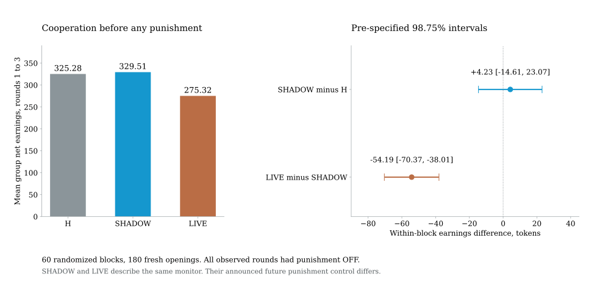

# Research overview

A language monitor becomes part of the strategic environment when agents know
its warnings can activate punishment. This project studies how that announced
control changes cooperation and how the messages agents produce alter the
context used to assess later language.

## The announcement effect

I separated a description of monitoring technology from the control assigned
to its output. Each of 60 randomized blocks contains 1 fresh H game, 1 SHADOW
game and 1 LIVE game. SHADOW and LIVE describe identical technology, while
SHADOW explicitly excludes language scores from punishment and payoff rules.
All games announce 15 rounds, with collection paused after round 3. Punishment
is unavailable during those rounds.

Mean opening group earnings are 325.28 under H, 329.51 under SHADOW and 275.32
under LIVE. LIVE minus SHADOW is −54.19 tokens (−16.45%), with pre-specified
98.75% interval [−70.37, −38.01]. SHADOW minus H is +4.23 [−14.61, 23.07].
The pre-specified position rule places SHADOW closer to H. This locates an
opening loss in the announced future control arrangement, without requiring
any realized punishment and without establishing equivalence between H and
SHADOW. The comparison concerns this model and wording.

## The earlier complete games

The earlier 6-block comparison ran 12 fresh games through all 15 rounds.
Mean group earnings were 1,727.4 under H and 1,360.4 under the language policy.
All 6 contrasts were negative, with mean −367.0 and exploratory 95% interval
[−566.26, −167.74]. No sanction deductions occurred, so lower contributions
accounted for the observed earnings difference.

The opening LIVE minus H contrast was −91.8 in that sample and −49.96 in the
new study. Fully cooperative H openings were 4/6 and 9/60. The smaller new
opening estimate cautions against treating the earlier full-game magnitude as
stable. The new experiment has no rounds 4 to 15, so it cannot calculate a
replacement full-game estimate or establish persistence of the new effect.

## The reference feedback

In a separate experiment, 4 producer pairs generate messages under different
authority over enforcement. Their messages become candidate references for
recipients who see both texts. Changing the selected reference while holding
that exposure fixed produces a mean probability-weighted continuation effect
of −7.296 group tokens. Recipients generate new messages and freely choose
contributions before settlement. The model weights and threshold stay fixed.

This controlled reference effect supplies a second part of the institutional
feedback problem. Its branches are dependent continuations from a shared
archived history, so the experiment remains separate from the randomized
announcement and complete-game estimates.

## Designing control

The next question is how language should receive punishment control when its
announced role already changes cooperation. A new rule needs an explicit
payoff benchmark and a complete-game evaluation after adaptation. Reference
updating provides a further design choice within that question. The
[design note](future-mechanism.md) records what a future comparison must vary.
The [forecast audit](../studies/early_warning/) remains an exploratory reuse of
6 earlier H games, rather than an evaluation of a new punishment policy.
